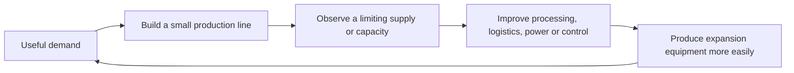

# Factorio Design Analysis And Applications To CWI

Reviewed 12–13 October 2026. **Research and proposals only.** This study does not
change recipes, quests, machines, worldgen, or gameplay.

Factorio makes production rewarding by connecting four things: recurring
demand, visible limits, tools that solve those limits, and easier expansion.
CWI already has much of the required machinery. Its largest opportunity is to
connect that machinery through useful production projects and clearer operating
feedback, before expanding the unfinished Electrical Age.

## Sources And Version Boundaries

The review read 24 official wiki pages covering progression, production,
resources, power, logistics, controls, construction, statistics, and Space Age.
It compared these systems with current CWI scripts, quest tasks, removal lists,
configuration, and selected installed Create classes and native recipes.
[Retained evidence](audit/FACTORIO_DESIGN_EVIDENCE.json) records source URLs,
revision IDs, fingerprints, qualifications, and CWI anchors. It contains no
personal filesystem paths or timezone information.

The wiki homepage currently lists stable **2.0.77**, experimental **2.1.21**,
and says the wiki describes **2.1**. Current article tables must not therefore be
treated wholesale as stable base-game features. Space Age planets and quality
are explicitly distinguished below. This is a source study, not a Factorio or
CWI playthrough; it does not establish enjoyable pacing or live machine rates.

Several sources need qualification:

- The fluid article contains older per-pipe pressure explanations beside the
  current segment model. Current uninterrupted segments transfer fluid without
  internal distance-based flow resistance; their size and input/output
  interfaces impose limits. Do not use the older explanation or transfer its
  numerical limits to Create.
- The quick-start guide contains older campaign and science terminology. Its
  teaching sequence is useful; its exact onboarding instructions are not a
  current recipe reference.
- Productivity can improve output per input while reducing output per second
  through a speed penalty. The module article's general advice requires this
  qualification.
- Expansion stack inserters create stacks on belts. Those are different from
  inventory stacks; ordinary base-game belt throughput should not be multiplied
  by an inventory stack size.
- Circuit-connected splitters were introduced in 2.0.67 according to the
  circuit article. Other recent device options require their own version check.

## How Factorio's Whole Loop Works

The player begins with direct, understandable operations: mine a resource,
smelt it, and build a machine. Increasing production makes hand delivery
repetitive. Belts and inserters remove that work, electricity supports more
machines, and automatic production supplies the next expansion.

Research provides a persistent consumer. Labs repeatedly consume several
science types together, so useful progress depends on a functioning network
of mines, smelters, intermediate production, transport, power, and science
assembly. Assemblers do not recursively craft missing ingredients; the player
builds and connects those earlier operations. A shortage in one required
science type can constrain the whole research system.

Research returns practical capability: new processes, transport systems,
construction tools, or improvements to existing production. Some current
technologies acknowledge actions such as mining or crafting rather than
consuming science. The player can then improve an existing factory and pursue
a larger objective. Finite ore supply, new distances, oil balancing, power,
and enemies change which constraint matters next.

The important relationship is:

Science works because it repeatedly tests the connected factory and pays back
the investment. Adding flasks or large ingredient counts alone would not
reproduce that effect. CWI should use its existing construction and restoration
needs. Its quests record progress and teach; they must not become recipe locks.

## Production And Optimization

### A Rate Is Different From A Yield

Factorio separates products per second, products per resource, and products per
energy. Modules make those objectives explicit: speed increases capacity with
costs, productivity improves resource yield with costs, and efficiency reduces
energy demand. Upgrading one machine can expose a new shortage elsewhere.

CWI already has useful versions of these choices:

| Current CWI Choice | What Actually Improves | What Still Constrains It |
| --- | --- | --- |
| Manual versus mixed andesite compound | Mixing produces 50% more compound per clay/powder pair; each ingredient per compound falls by one third. | Mixer construction, power, and feed supply. |
| Vibration versus centrifugation | Main concentrate chance rises from 0.32 to 0.42: 31.25% more per powder. | Nominal recipe time rises from 120 to 200 ticks; machine behavior differs. Improved recovery is not automatically faster production. |
| Air versus oxygen steel refining | Pig-iron recovery rises from 90% to 95%; the normalized refining output rate is about 3.17 times higher. | Oxygen preparation, doubled pig-iron batch input, silicon, heat, casting, and output space. |
| Larger furnace structure | More available parallel capacity. | Supplies, output handling, achievable heat, and the parallel count actually runnable. |
| More furnace heat | Shorter recipe duration and higher heat eligibility. | Heater strength, reinforcement ceiling, fuel, warmup, and downstream capacity. |
| Faster mixing vessel | Duration scales with `MAX_RPM / abs(RPM)`, with rounding and a minimum of one tick. | Drive speed/capacity, continuous ingredients, and empty output space. |

Sources: [compound recipes](../kubejs/server_scripts/Progression/MechanicalAge.js#L43)
and [mixing](../kubejs/server_scripts/Progression/MechanicalAge.js#L887);
[ore parameters](../kubejs/startup_scripts/Preload/Global.js#L247) and
[separation](../kubejs/server_scripts/Recipes/ProcessingLine.js/Ore.js#L87);
[furnace structure and heat](../kubejs/server_scripts/Multiblocked2/BlastFurnace.js#L20),
[steel routes](../kubejs/server_scripts/Multiblocked2/BlastFurnace.js#L288), and
[mixing vessel](../kubejs/server_scripts/Multiblocked2/MixingVessel.js#L3).

The steel comparison uses 810 mB / 600 nominal ticks versus 1,710 mB / 400
nominal ticks at equal heat scaling and effective parallelism. These nominal
durations are recipe parameters, not measured operating times. Actual steel
operation needs superheat, which already modifies duration. The 3.17 ratio is
for refining capacity, not a promise of 3.17 times more steel from the same
mine or complete plant.

For a fixed setup, a useful planning estimate is:

`output per minute = expected output per batch × runnable parallel batches × 1200 / effective duration in ticks`

This assumes Minecraft sustains 20 ticks per second, uninterrupted supply, and
available output space. Create operations need their own effective timing;
one formula must not replace their actual speed rules. Probabilistic products
need averages across many batches. A stored pile is also not a production rate.

### Alternatives Should Change A Factory Decision

Factorio's basic oil processing establishes a simple first supply. Advanced oil
processing offers better overall output but requires management of three
products. Cracking moves surplus toward a shortage. Coal liquefaction changes
the resource source and location choices while adding coal/steam dependencies
and a starter/return flow.

CWI's oxygen steel is already a strong example: the first air route remains
practical; later separation infrastructure improves an established plant.
Ore recovery routes can similarly trade reagents and machines for less mining.
The wax-oil lubricant branch competes with cracking and has several coproducts.
Show these tradeoffs before adding more alternative recipes.

For each proposed alternative, record the difference in resource efficiency,
capacity, supply infrastructure, space, and output handling. A new name and a
longer ingredient list are insufficient. Factorio's own oil and material
recipes are gameplay abstractions, not authorities for chemical realism.

## Logistics, Buffers, And Control

### Different Transport Systems Solve Different Problems

| Factorio Role | CWI Application | Qualification |
| --- | --- | --- |
| Belts expose continuous flow and congestion. | Create belts connect understandable local workshops and show where work accumulates. | Create belts need kinetic drive and have different mechanics; Factorio belt lanes and rates do not transfer. |
| Trains deliver bulk material between distant stations. | Connect an actual mineral shortage to a remote deposit or processing site. | Loading, unloading, schedules, buffers, and traffic all affect sustained delivery. Distance alone does not determine the best system. |
| Robot logistics offer flexible source-to-request delivery. | Packages and stock/request networks can fill a comparable flexible distribution role. | This is a design analogy. Packages are not robots; routing and capacity require their own test. Robots can also support high local throughput. |
| Pipes distribute fluid locally; wagons and barrels serve other delivery needs. | Use pipes for a plant, bulk fluid transport for distant supply, and containers where mixed delivery is useful. | Do not copy Factorio flow behavior or assume every CWI fluid has every container route. |

An equipment workshop can begin with local storage and hand collection.
Filtered distribution and requests should improve it as capabilities become
available. There is no need to weaken existing storage systems or force one
transport method for every material.

### Buffers Buy Time; They Do Not Solve A Permanent Surplus

Factorio advanced oil processing stops when any compulsory output fills.
Storage can delay that condition; consumers, conversion, and controlled
production sustain operation. Different products have different demand rates,
so a fixed machine ratio rarely answers every operating situation.

CWI's ore, coking, distillation, glass, and steel lines similarly deserve
deliberate output destinations. Slag already has casting and onward uses;
glass rejects have lossy reclamation. Other streams need their actual remaining
native consumers, fuel behavior, removal lists, and machine output rules checked
before being classified as dead ends.

For every multi-output demonstration, identify the compulsory products,
normal consumers, temporary buffers, overflow response, and eventual route for
surplus. An optional recovery route should be useful without requiring the
player to need its product forever. If no durable sink exists, a disposal
proposal needs a specific mechanism and a reason recovery remains worthwhile.

### Feedback Starts With A Simple Stock Target

Factorio circuits separate reading a quantity from acting on it. Many useful
controls need only a comparison: allow production below a target, reserve
essential fluid, or enable surplus conversion above a reserve.

CWI already has source-supported tools for this. Installed Create 6.0.8
registers the Threshold Switch as **`create:stockpile_switch`**. Its native
recipe uses an electron tube, brass casing, and comparator, and is not targeted
by current recipe removal or hiding. Its class has upper/lower switching values,
inventory and tank observation, inversion, and filtering. Clutches, redstone
links, gauges, and display links also have surviving native recipes.

Introduce controls when their ingredients are reachable. Before that, use small
bounded stock reserves and simple line layouts. Later, demonstrate a producer
that restarts at a lower stock level and stops at a higher level, avoiding rapid
switching. Preserve feed for an essential consumer before opening optional
cracking. Do not claim an exact multi-condition circuit works until tested with
the relevant blocks and machine.

### Teach Circulation Before Complex Balancing

Glass already returns soda and limestone. Paper returns forming fabric.
These make a good early lesson: retain the reusable feed locally, send finished
products elsewhere, and provide enough circulating stock to restart the line.
This prepares players for catalysts, molds, and reusable cultures.

The glass additive return is an intentional gameplay simplification. Keep it.
Do not copy Factorio's general resource drain into every CWI recipe. The removed
Fermento, Carbofusor, and Putrelys revival routes also stay removed; a proposed
biology project must use a genuinely available activation path.

Sources: [glass](../kubejs/server_scripts/Recipes/ProcessingLine.js/Glass.js#L3),
[paper](../kubejs/server_scripts/Recipes/ProcessingLine.js/Paper.js#L44),
[lubricant branch](../kubejs/server_scripts/Recipes/IndustrialSupplies.js#L24),
[oil fractionation](../kubejs/server_scripts/Recipes/Chemistry.js#L288).

## Expansion, Measurement, And Failure

Factorio blueprints turn a solved layout into reusable knowledge. Ghosts and
material lists aid planning; construction robots later repeat placement using
real supplies. Designing the first working module and copying it are different
tasks. Easier repetition lets demand grow without equivalent manual labor.

CWI already has a mechanical-tier schematicannon recipe and quest, construction
wands, and shared machine components. Teach one tested press/pump/storage
module, then let the player capture and reproduce it. Verify orientation,
settings, power, fuel, and fluid connections. Do not assume every custom MBD
state survives schematic placement. Provided schematics should illustrate
principles and leave room for player designs.

Production statistics in Factorio show production and consumption over several
time periods. Stored inventory is a separate quantity. Short rate samples can
mislead. Machine status and visible transport help locate a failure before the
player redesigns the whole factory.

CWI's static JEI planning already shares ore yield data with recipes. Extend
that only where a comparison changes planning. For live furnace information,
prioritize actual heat, achievable ceiling, effective parallelism, missing
feed, and blocked output. Display the identified limiting condition when the
API makes it available; otherwise show the observed values rather than invent
a diagnosis.

Create gauges, Jade, and Connected dashboard are installed. A Create Stats
configuration exists, but no matching installed mod was found; it does not
establish production charts as a current capability. Automatic rate history
would be a separate verified implementation. A manual sustained test with
known input/output storage is a useful first alternative.

Sources: [schematicannon recipe](../kubejs/server_scripts/Recipes/Mods/Create.js#L242),
[schematicannon quest](../config/ftbquests/quests/chapters/kinetic_enlightenment.snbt#L829),
[precision observer](../kubejs/server_scripts/Progression/PrecisionAge.js#L359),
[planning data](../kubejs/client_scripts/JEI/ProductionPlanning.js#L2).

## Pressure And Geography

Factorio's ore patches, distance, energy demand, and pollution make expansion
have consequences. Pollution reaching nests triggers attacks; pollution
generation also contributes to evolution. Cleaner power alone does not remove
pollution from all production machinery. Players have visible information and
countermeasures rather than a purely arbitrary timer.

CWI need not add pollution or attacks to borrow this relationship. Mechanical
stress, heater supply, reinforcement, ore geography, reagent supply, and filled
outputs already connect factory operation to constraints. Improve their
visibility and available remedies first. A hazard is useful design only when
players can anticipate it, take a sensible action, and understand the result.

Compound ores already link main products, byproducts, sulfur behavior,
leachability, and host rocks. A remote deposit can solve a secondary shortage,
not simply provide more of the same ore. Choosing local processing versus
shipping raw material can change transport and waste placement. CWI worldgen
rules describe expectations, not guaranteed deposits or Factorio-style resource
tile behavior. Renewable biological reserves should be evaluated against their
actual access, inputs, and rate rather than presumed to erase mining.

## What Space Age Adds To The Lesson

These are expansion examples, not universal base-game systems. Their value is
how they change the dominant operating problem.

| System | Distinct Factory Problem | Lesson That Fits CWI |
| --- | --- | --- |
| Vulcanus | Abundant molten feeds, casting capacity, terrain, coproduct stone, and territory. | Molten production should make casting, transport, and output handling matter alongside furnace capacity. |
| Fulgora | Scrap supplies mixed advanced components; sorting and selective recycling matter on separated islands with limited land. | Use CWI's salvage opening to teach retain/recover/sort decisions. Finite toolbox loot is not an industrial perpetual supply. |
| Gleba | Renewable biology has freshness, spoilage, and interconnected circulation; stockpiling can reduce usefulness. | Borrow demand matching and renewable process planning. Do not add spoilage or culture failure merely to imitate it. |
| Aquilo | Remote imports, liquid resources, constructed ground, and sustained heating require several mature supply chains. | A future restoration facility could test established supply networks together. This remains later design, not an Electrical Age task now. |
| Quality | Selective vertical improvement competes with adding more machines, while chance outputs require sorting. | First make existing grades, reject recovery, and furnace upgrades valuable. Universal random quality tiers would add inventory and maintenance cost. |

Quality requires expansion ownership but is a separate official mod that can
run without most Space Age content. Its costs and random-output economy are
not automatically appropriate for CWI.

CWI can change its operating problem within existing chapters:
salvage and sorting → reusable-input circulation → probabilistic separation →
heat and slag management → petroleum reserves → repeatable precision supply.
That gives progression variety without repeating the same assembly with
increasing ingredient counts.

## Recommended CWI Projects

All entries below are proposals. Use a small number of connecting projects;
keep material/geography references factual and avoid lessons for every item.

| Priority | Project | Concrete Benefit | Scope And Tradeoff |
| --- | --- | --- | --- |
| 1 | Mechanical equipment resupply | Automate compound, alloy, sheets, and a few frequently used construction parts. Spend them on another useful station. | Derive a supply target from an actual construction bill. Initially use accessible reserve storage; add threshold control when its ingredients are available. Avoid requiring automation of every tool. |
| 1 | Circulating glass workshop | Pump water, retain reusable additives, separate finished glass from rejects, optionally reclaim rejects. | Use current recipes. Demonstrate restarting and output handling, not a promise of perfect recovery or an added carbonate burden. |
| 1 | First steel works | Connect coke, pig iron, air refining, casting, and deliberate creosote/CO₂/slag handling. | Keep the blast furnace as producer. Teach feed, heat, reinforcement, output space, and parallel limits independently. Confirm each stream's accessible destination. |
| 2 | Stock control demonstration | One switch and controlled branch keep a useful reserve without constant production or rapid switching. | Test exact block compatibility and signal polarity. A small standalone example is enough; ordinary production need not require circuits. |
| 2 | Replicate a proven workshop | Use the schematicannon to grow capacity with known materials and a tested layout. | Validate placement and power/fluid connections in game. Supply optional examples rather than one mandatory optimal factory. |
| 2 | Ore recovery comparison | Compare mining demand, expected yield, reagent burden, and processing capacity. | Use shared ore data and repeated samples. Centrifugation is improved recovery, not universally higher throughput. |
| 3 | Upgrade existing steel to oxygen | Make better recovery and refining capacity repay oxygen-plant investment. | Compare the complete plant as well as the isolated recipe. Avoid steel-dependent machinery in the bootstrap route. |
| 3 | Repeatable precision supply | Use existing chip automation to supply filtered distribution or another assembly station. | Manual chips start from a circuit board; automated chips start from brass sheet. Preserve the initial route and explain the resulting capability. |
| 3 | Remote mineral supply | Solve a known material/byproduct bottleneck through geography and suitable transport. | Let the player choose belts, packages, or trains. Do not demand every biome or require railway for a nearby deposit. |
| Later | Petroleum reserve and surplus control | Protect lubricant/essential feeds while converting genuine excess toward demand. | Verify all remaining consumers, output rules, and controls first. Storage alone is not the final solution. |

The first three projects offer the strongest early improvement with existing
mechanics. A later narrative objective should consume capabilities developed
through these projects. Staff records may imply earlier engineers' priorities
through small incidents; reliable operating instructions must stay clear.
Astronomical measurements, restored systems, and final Stargate operation are
not yet implemented objectives.

## Quest And Balance Integration

Use **discovery → commissioning → optional mastery**. Current early chapters
mostly detect possession: Mechanical has 63 item tasks and one checkmark;
Fluid Mechanics has 27 item tasks; Precision has 70 item tasks and one
checkmark; Heavy Industry has 59 item tasks and one checkmark. These are task
entries, not quest counts. None of these four chapters has a reward block.

Possessing an item does not prove an automated or continuously running line.
Start with honestly labeled commissioning checklists; automatic production
detection would need a separate implementation. Leave quest completion
informational. Improvements should pay back through actual capability, reduced
work, better yield, or capacity, rather than arbitrary reward stacks.

Before increasing demand or adding a process, answer these questions:

1. What useful construction or operating goal needs this output repeatedly?
2. Which real constraint changes: resources, speed, space, power, routing, or control?
3. Is the bootstrap possible without the capability it is meant to unlock?
4. Can players make expansion equipment and repeat a successful layout?
5. What happens when a compulsory output is no longer needed?
6. Can players identify and remedy a stopped line?
7. Does the upgrade repay its setup cost while the simpler route remains usable?

Calibrate with a small playtest: first successful batch, first complete line,
time supplying the next construction bill, frequency of manual intervention,
blocked-output events, and time to duplicate capacity. Sample chance outputs
over enough batches to avoid judging luck. Source inspection alone cannot set
an enjoyable number of minutes or a mandatory production target.

## Development Applications

Keep operation data authoritative. CWI already generates recipes and JEI
information from shared ore values; extend that pattern rather than separately
typing recipe quantities, averages, and client displays. Machine status should
read persisted per-machine state, not substitute globals. Any new metric needs
a defined sample period and must distinguish theoretical capacity from output.

For the first implementation batch, prefer teaching, diagnostics, and a tested
example over new chemistry or machinery. Preserve recipe IDs and deliberate
abstractions. Validate the installed API, actual recipe graph, and in-game
operation before claiming a proposal works. Electrical expansion follows the
refinement of the existing opening.

Related references: [current CWI factory analysis](FACTORY_DESIGN_ANALYSIS.md),
[reference-pack study](NO_FLESH_WITHIN_CHEST_2_ANALYSIS.md),
[steel design](STEEL_PRODUCTION_DESIGN.md), and
[quest facts](QUEST_FACT_CONFIRMATIONS.md).

## Official Wiki Reading Map

Links identify the reviewed revisions. The evidence file lists all 24 pages.

| Topic | Primary Sources |
| --- | --- |
| Recurring demand and capability | [Research](https://wiki.factorio.com/index.php?title=Research&oldid=217102), [science packs](https://wiki.factorio.com/index.php?title=Science_pack&oldid=219334), [technologies](https://wiki.factorio.com/index.php?title=Technologies&oldid=219704) |
| Supply and production graph | [Crafting](https://wiki.factorio.com/index.php?title=Crafting&oldid=217120), [mining](https://wiki.factorio.com/index.php?title=Mining&oldid=219472) |
| Capacity and operating cost | [Modules](https://wiki.factorio.com/index.php?title=Module&oldid=219685), [power](https://wiki.factorio.com/index.php?title=Power_production&oldid=220373) |
| Transport roles | [Belts](https://wiki.factorio.com/index.php?title=Belt_transport_system&oldid=216925), [railway](https://wiki.factorio.com/index.php?title=Railway&oldid=220228), [logistic network](https://wiki.factorio.com/index.php?title=Logistic_network&oldid=217013) |
| Coproducts and control | [Oil processing](https://wiki.factorio.com/index.php?title=Oil_processing&oldid=218469), [circuits](https://wiki.factorio.com/index.php?title=Circuit_network&oldid=220060), [control examples](https://wiki.factorio.com/index.php?title=Tutorial:Circuit_network_cookbook&oldid=220086) |
| Feedback and repeated construction | [Production statistics](https://wiki.factorio.com/index.php?title=Production_statistics&oldid=217118), [blueprints](https://wiki.factorio.com/index.php?title=Blueprint&oldid=217341) |
| Geography and consequences | [Pollution](https://wiki.factorio.com/index.php?title=Pollution&oldid=219195), [fluid system with qualifications above](https://wiki.factorio.com/index.php?title=Fluid_system&oldid=217490) |
| Expansion constraints | [Vulcanus](https://wiki.factorio.com/index.php?title=Vulcanus&oldid=219039), [Fulgora](https://wiki.factorio.com/index.php?title=Fulgora&oldid=220418), [Gleba](https://wiki.factorio.com/index.php?title=Gleba&oldid=219999), [Aquilo](https://wiki.factorio.com/index.php?title=Aquilo&oldid=217537), [quality](https://wiki.factorio.com/index.php?title=Quality&oldid=219735) |
