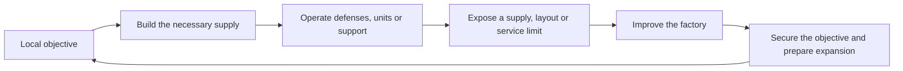

# Mindustry Design Analysis And Applications To CWI

Reviewed 13 October 2026. **Research and proposals only.** No recipes, machines,
quests, assets, or other gameplay files were changed for this study.

Mindustry connects production to an immediate job: supply defenses, construct
units, repair damage, or establish another base. Its strongest contribution to
CWI is this relationship between an operating factory and a useful project.
The early chapters can use existing machinery to establish, test, improve,
and reproduce useful workshops before extending the unfinished Electrical Age.

## Evidence And Version

The study read 69 distinct official wiki content/manual pages, plus the wiki
homepage, and inspected official source for production, heat, power,
construction, research, and campaign behavior. The comparison checks current
CWI recipes, machine scripts, JEI displays, and quests. The
[evidence inventory](audit/MINDUSTRY_DESIGN_EVIDENCE.json) records public URLs,
fingerprints, source locations, calculations, and qualifications.

The homepage reports **160.7**. The official release is
[v8 Build 160.7](https://github.com/Anuken/Mindustry/releases/tag/v160.7), published
8 October 2026. Source references use that release, resolved to commit
`17012d61d9e4c3cbd9820d87e81c24495486ac53`. The wiki repository revision was
also recorded; it does not prove the exact provenance of every deployed page.

This is a source study, not a Mindustry or CWI playtest. Generated statistics
describe nominal operation. They do not establish enjoyable pacing, practical
layout rates, or CWI machine compatibility. The planet pages contain little
campaign explanation, and the logic manual declares itself incomplete. Source
inspection fills specific gaps; this report does not claim an exhaustive
review of every block, map, or line of Mindustry code.

## How Its Factory Loop Works

A core stores construction materials and anchors a base. Losing it can lose
the sector. Drills, processors, transport, and power supply the things that
keep the base functioning. Turrets turn supplied materials into combat
capability; unit factories and reconstructors turn an established supply
network into mobile capability. Construction, research, operating supplies,
and replacement needs compete for useful materials.

The consequence is visible outside the producing machine. A successful
graphite plant supplies more effective ammunition or more advanced equipment.
A silicon shortage can constrain construction and unit production. Repair and
building support let the player spend less effort repeating earlier work.
Sector objectives then ask the player to apply those capabilities in another
setting with different terrain, resources, threats, and space.

Demand is conditional. Ammunition is consumed while firing; unit production
can stop at its cap; research has an end. These are recurring or episodic
needs, rather than proof that every material has an infinite sink.

For CWI, a useful equivalent is supplying the equipment for the next workshop,
operating a geographically valuable installation, or eventually restoring a
system that visibly works. Merely collecting the next machine does not test
the connected production line. Equally, demanding a large delivery with no
use or observable result would add work without reproducing Mindustry's payoff.

## Materials Have Several Jobs

Mindustry makes common resources relevant in different contexts. Copper can
be construction stock or basic ammunition. Graphite supports processing,
construction, and stronger ammunition. Silicon supports equipment, units,
and a different ammunition behavior.

The [Duo](https://mindustrygame.github.io/wiki/content/blocks/turret/349-duo/)
illustrates this clearly. Copper provides 9 damage and 2 ammunition per item;
graphite provides 18 damage, 4 ammunition per item, extra range, and slower
firing; silicon adds homing and faster firing. The choice changes supply
requirements and battlefield behavior. Damage alone does not establish the
best ammunition. The
[Scatter](https://mindustrygame.github.io/wiki/content/blocks/turret/350-scatter/)
has a separate air-defense role, while the
[Swarmer](https://mindustrygame.github.io/wiki/content/blocks/turret/357-swarmer/)
offers other ammunition effects.

CWI already has different mineral roles in its
[ore definitions](../kubejs/startup_scripts/Preload/Global.js#L256): main metal,
secondary products, sulfur, host rock, and acid suitability. Those properties
can affect which deposit is valuable to a particular factory. A secondary
metal shortage can justify a different ore source or separation route.
The [compound-mineral JEI category](../kubejs/client_scripts/JEI/CompoundMinerals.js)
already makes much of this visible.

The improvement should be a useful comparison at a real decision: which source
can supply the current shortage, and what additional processing does it need?
Do not manufacture a new use for every intermediate or add scientific padding
to every material entry. Unnecessary uses increase the recipe graph and can
make material identities less clear.

Research also differs from Factorio. Mindustry's
[research implementation](https://github.com/Anuken/Mindustry/blob/v160.7/core/src/mindustry/ui/dialogs/ResearchDialog.java#L212)
pools eligible sector inventories and spends actual stored materials, with
partial contributions supported. It does not use Factorio's continuous
laboratory consumption model. Its lesson for CWI is competition between real
material needs. CWI's quests must retain their informational role; resource
payments and recipe locks are separate design changes with no authorization
or demonstrated need here.

## Upgrades Change The Connected Factory

### Throughput, Yield, And Cost Are Separate

Mindustry's processing upgrades give measurable benefits and new obligations.

| Machine | Nominal Recipe And Rate | Direct Services And Space |
| --- | --- | --- |
| [Graphite Press](https://mindustrygame.github.io/wiki/content/blocks/crafting/181-graphite-press/) | 2 coal → 1 graphite per 1.5 seconds; about 0.667 graphite/s. | 2×2; no power or water requirement. |
| [Multi-Press](https://mindustrygame.github.io/wiki/content/blocks/crafting/182-multi-press/) | 3 coal → 2 graphite per 0.5 seconds; 4 graphite/s. | 108 power/s, 6 water/s, 3×3. |
| [Silicon Smelter](https://mindustrygame.github.io/wiki/content/blocks/crafting/183-silicon-smelter/) | 1 coal + 2 sand → 1 silicon; 1.5 silicon/s. | 30 power/s, 2×2. |
| [Silicon Crucible](https://mindustrygame.github.io/wiki/content/blocks/crafting/184-silicon-crucible/) | 4 coal + 6 sand + 1 pyratite → 8 silicon per 1.5 seconds; about 5.333 silicon/s before terrain effects. | 240 power/s, 3×3, additional pyratite supply. |

The Multi-Press gives six times the output of one Graphite Press and uses 25%
less coal per graphite. It nevertheless needs 4.5 times the coal delivery rate
of one starting press. Replacing a machine without increasing its feed cannot
deliver the listed output.

The silicon upgrade halves direct coal per product and reduces direct sand per
product by 62.5%. Its direct electricity per silicon rises from 20 to 45 power
units, before terrain effects and before paying for pyratite production.
An advanced machine can therefore repay investment in capacity, resource
recovery, or compactness without winning every comparison.

CWI already has comparable choices: manual versus mixed compound, physical
separation versus better recovery, and air versus oxygen steel. The
[Factorio study](FACTORIO_DESIGN_ANALYSIS.md#production-and-optimization)
calculates those examples. Mindustry adds a useful teaching approach: improve
one operating limitation, then observe what becomes limiting next.

For steel, compare the complete supply plant as well as the refining batch.
The [air route](../kubejs/server_scripts/Multiblocked2/BlastFurnace.js#L288)
supplies first steel; the
[oxygen route](../kubejs/server_scripts/Multiblocked2/BlastFurnace.js#L305)
later improves recovery and refining capacity. Oxygen production, pig-iron
supply, heating, casting, and output handling determine the actual benefit.
Steel remains in the blast furnace, and its bootstrap must not require
steel-dependent machinery.

### Optional Supply Makes Infrastructure Rewarding

The [Mechanical Drill](https://mindustrygame.github.io/wiki/content/blocks/production/325-mechanical-drill/)
works without water. Supplying 3 water/s gives a listed 2.56× speed boost.
The [Laser Drill](https://mindustrygame.github.io/wiki/content/blocks/production/327-laser-drill/)
has the same listed multiplier with a 4.8 water/s booster and an electrical
requirement. Improving an existing mine's services is a substantial project
before replacing the mine itself.

Support blocks use a similar pattern. A
[Mender](https://mindustrygame.github.io/wiki/content/blocks/effect/245-mender/)
can accept optional silicon for improved repair service; an
[Overdrive Projector](https://mindustrygame.github.io/wiki/content/blocks/effect/247-overdrive-projector/)
can accept phase fabric for greater effect. A functioning baseline makes the
extra supply feel like an earned improvement.

CWI can deliver this through existing mixer RPM and furnace heating choices.
The [furnace](../kubejs/server_scripts/Multiblocked2/BlastFurnace.js#L20)
already separates several improvement dimensions:

- Brick/hatch counts establish available parallel capacity.
- Heater strength establishes a temperature target.
- Reinforcement limits the permitted temperature.
- Warmup establishes current temperature; temperature affects duration and
  discrete recipe heat eligibility.

A player with insufficient reinforcement should not be told simply to add
more heaters. A large furnace with inadequate feed does not need still more
parallel capacity. Teach the particular limit and the improvement that changes
it. Additional coolant, catalysts, or service networks would need a separate
reason; the existing choices already provide useful depth.

## Logistics Is A Small Vocabulary Of Decisions

Mindustry exposes different routing operations as recognizable blocks.

| Operation | Mindustry Example | Question For A CWI Layout |
| --- | --- | --- |
| Identify | [Sorter](https://mindustrygame.github.io/wiki/content/blocks/distribution/264-sorter/) | Which item belongs in this branch? |
| Distribute | [Router](https://mindustrygame.github.io/wiki/content/blocks/distribution/266-router/) | How should several consumers share a feed? |
| Prioritize forward | [Overflow Gate](https://mindustrygame.github.io/wiki/content/blocks/distribution/268-overflow-gate/) | Which destination receives material before surplus is diverted? |
| Prioritize sides | [Underflow Gate](https://mindustrygame.github.io/wiki/content/blocks/distribution/269-underflow-gate/) | Which side branches should fill before the forward route? |
| Constrain admission | [Armored Conveyor](https://mindustrygame.github.io/wiki/content/blocks/distribution/260-armored-conveyor/) | Which connections are allowed to inject material here? |
| Match a destination | [Cargo Loader](https://mindustrygame.github.io/wiki/content/blocks/distribution/281-unit-cargo-loader/) and unload filters | Which receiving station requests this material? |

Filtering does not establish priority. Equal distribution does not reserve
startup stock. A useful teaching example should show the operation the player
actually needs, rather than describe all transport as filtering.

The Titanium and Armored Conveyors are both listed at 10 items/s; the latter
rejects non-conveyor side input. Its improvement includes a more predictable
interface. The Erekir
[Duct Router](https://mindustrygame.github.io/wiki/content/blocks/distribution/274-duct-router/)
accepts input only from the back, distributes in three directions, and can
filter. Connection behavior can be as valuable as greater nominal speed.

Capacity also includes the endpoints. The
[Plastanium Conveyor](https://mindustrygame.github.io/wiki/content/blocks/distribution/259-plastanium-conveyor/)
explicitly needs multiple loading and unloading points to reach peak
throughput. A [Mass Driver](https://mindustrygame.github.io/wiki/content/blocks/distribution/271-mass-driver/)
collects and sends batches; a poorly supplied sender cannot realize its
headline capacity. CWI examples should check extraction, transport, processing,
unloading, and receiving space together.

Respect CWI's actual access order. Basic andesite
[funnels](../kubejs/server_scripts/Progression/MechanicalAge.js#L861) and
[tunnels](../kubejs/server_scripts/Progression/MechanicalAge.js#L873) precede
brass [funnels](../kubejs/server_scripts/Progression/PrecisionAge.js#L145) and
[tunnels](../kubejs/server_scripts/Progression/PrecisionAge.js#L159), which use
control chips. Sophisticated mixed-output routing must not be promised in the
opening before accessible hardware and a working layout are verified. Packages
and frogports offer a comparison to destination-based delivery, but their
behavior is not mechanically equivalent to Mindustry drones.

## A Workshop Needs An Operating Contract

A reusable layout should explain what enters, what stays inside, what leaves,
how it starts, and how it recovers. A schematic alone cannot express all these
conditions.

The existing [glass line](../kubejs/server_scripts/Recipes/ProcessingLine.js/Glass.js)
is a suitable first example:

| Part | Glass Workshop Contract |
| --- | --- |
| Feed | Sand, quench water, and supplies for the chosen processing/drive setup. |
| Working inventory | Soda and limestone return from batch mixing; retain enough locally to continue and restart. |
| Products | Usable glass goes to a real construction stock or consumer. |
| Rejects | Cracked/devitrified glass can be milled; four powder portions reclaim one sintered blank. |
| Startup | Load circulating additives, establish drive/heat/water, then introduce feed. |
| Interruption | Check what remains in machines and transport, refill the missing supply, and resume without exporting the circulating stock accidentally. |

Reject recovery is lossy: milling produces two guaranteed powders plus chance
outputs, with a maximum of four, while reclaiming requires four. It cannot
promise one recovered glass per reject. Returned soda and limestone remain an
intentional gameplay simplification. Commissioning this line does not justify
consuming them or redesigning their supply routes.

Two useful stock quantities follow from this contract. A construction bill
contains blocks and components to build another workshop. Startup stock
contains the circulating inputs and operating reserve needed to run it.
Counting an existing line's reusable additives as spare expansion material can
stop the original plant.

Mindustry draws builder requirements from core stock and saves schematic
position, rotation, and configuration. Support such as
[Poly](https://mindustrygame.github.io/wiki/content/units/21-poly/) and the
[Build Tower](https://mindustrygame.github.io/wiki/content/blocks/effect/252-build-tower/)
reduces future construction/rebuilding labor. CWI's existing
[schematicannon](../kubejs/server_scripts/Recipes/Mods/Create.js#L242) and
[construction wands](../kubejs/server_scripts/Recipes/Mods/ConstructionWand.js)
can serve that payoff. Test custom machine state, orientation, configuration,
and fluid/kinetic connections before publishing a working schematic.

## Startup Reliability And Recovery

Mindustry's [Impact Reactor](https://mindustrygame.github.io/wiki/content/blocks/power/316-impact-reactor/)
generates a nominal 7,800 power/s at full operation and consumes 1,500 power/s
itself. The direct net is 6,300 power/s, excluding fuel and cryofluid production.
It needs external startup power, blast compound, and 15 cryofluid/s. Its source
scales generation with warmup to the fifth power and requires nearly satisfied
power and other inputs to warm up. A plant with a positive steady balance can
still fail to start or recover after supply loss.

The [power graph](https://github.com/Anuken/Mindustry/blob/v160.7/core/src/mindustry/world/blocks/power/PowerGraph.java)
separates demand, production, battery storage, and supplied fraction. Reduced
power can reduce the service production that supports a generator. Batteries
bridge a finite interruption; they do not correct a permanent supply deficit.

CWI kinetic overload stops the affected network rather than reproducing that
electrical model. Its own startup question still matters: can pumps, feeders,
and processing loads operate with the available drive, and can essential feed
be established before adding the full load? The
[Stirling engine script](../kubejs/server_scripts/Multiblocked2/StirlingEngine.js#L16)
sets 32, 64, or 128 RPM according to heater state. These are shaft speeds,
not stress-capacity figures and not evidence of an Impact Reactor-style warmup.

Proposed commissioning checks should be player-initiated and reversible:
start from a known stock, run with normal supply, stop deliberately, restore
one missing input, and clear a full output. Record the remedy when a limit is
encountered. Check whether a separate essential drive or starter reserve helps
in the tested layout; do not prescribe it universally.

Mindustry's Thorium Reactor can overheat and explode, with heat and coolant
feedback. That does not establish a need for new CWI accidents. Existing
stoppages and supply limits can teach reliability without adding unannounced
destruction, compulsory timers, or maintenance chores.

## Terrain And Heat Make Location Matter

Mindustry drills repeatedly extract from ore-bearing tiles without consuming
the overlay. Covered resource tiles and hardness affect production. Cultivators,
oil extraction, and the silicon crucible also make terrain attributes relevant
to an installation. The crucible's source defines both speed and yield effects.
Generated wiki affinity rows include a map-loading placeholder, so they do not
establish a universal numerical bonus for a particular placement.

CWI ordinary mineral blocks are breakable, with
[ore/deposit loot](../kubejs/server_scripts/Loots/Loots.js#L447). Their exploration
role should remain different from a renewable operating reserve. The existing
[lava extractor](../kubejs/server_scripts/Multiblocked2/LavaExtractor.js#L20)
provides a native location-dependent installation: eruptive bedrock below its
head, at least 128 RPM, pump/RPM-dependent extraction, and a 4,000 mB tank.
It is a Precision-stage example, rather than an assumed opening capability.

A useful optional outpost project would find a valid site, establish drive and
delivery, and supply an actual lava consumer. Compare local processing with
shipping material to the main workshop. Generation definitions do not guarantee
a conveniently placed deposit. Trains, packages, belts, and pipes remain
choices whose practicality depends on the particular route.

Erekir adds directional heat infrastructure. An
[Electric Heater](https://mindustrygame.github.io/wiki/content/blocks/crafting/203-electric-heater/)
uses 100 power/s for 3 heat; a
[Slag Heater](https://mindustrygame.github.io/wiki/content/blocks/crafting/204-slag-heater/)
uses 40 slag/s for 8 heat. Redirectors and routers make supply geometry part of
the layout alongside item, fluid, and power access.

At v160.7 the Carbide and Surge Crucibles have a 40-heat full-efficiency target
and a 100% efficiency cap. With other supplies satisfied, 20 heat gives 50%
thermal efficiency; 40 or more gives 100%. Forty is not a hard startup gate,
and excess heat does not accelerate these two crucibles. The generic
[HeatCrafter](https://github.com/Anuken/Mindustry/blob/v160.7/core/src/mindustry/world/blocks/production/HeatCrafter.java)
supports other caps, so block configuration must be checked.

CWI's furnace uses discrete heat eligibility plus a temperature-dependent
duration modifier. Preserve that distinction. A shared heat-routing system
would require new machinery, state, feedback, and balancing. Showing current
temperature, achievable ceiling, and effective parallel operation is a smaller
and more relevant early improvement. Furnace particles and existing JEI
already convey some information; supplement those where diagnosis remains hard.

## Campaign Structure As A Teaching Model

Mindustry pairs capability acquisition with a setting that uses it. The
[Serpulo tree](https://github.com/Anuken/Mindustry/blob/v160.7/core/src/mindustry/content/SerpuloTechTree.java#L450)
combines sector completion with specific research prerequisites. Early links
include routing, repair/power, then graphite, kiln, and pumping capabilities.
The [Erekir tree](https://github.com/Anuken/Mindustry/blob/v160.7/core/src/mindustry/content/ErekirTechTree.java#L377)
combines transport, units, storage, slag, and heat across its sector sequence.
The next challenge applies capabilities already introduced.

Research counts are also adjusted for different materials: Erekir's tree gives
oxide a 0.5 multiplier, carbide 0.3, and phase fabric 0.2. The existence of an
advanced supply chain does not mean its research demand must be inflated
uniformly. CWI targets should likewise come from actual construction needs
and measured production effort.

For the first chapters, use a few connecting projects with distinct jobs:

| Stage | Useful Application | Different Operating Question |
| --- | --- | --- |
| Mechanical | Supply a second practical station from a small component workshop. | Can drive, feed, and output handling support normal construction demand? |
| Fluid handling | Operate the circulating glass workshop. | Can working stock stay inside while products and rejects leave? |
| Heavy Industry | Commission first coke/pig iron/air steel/casting supply. | Can heat, parallelism, and every compulsory output be supported together? |
| Precision | Improve a measured bottleneck or establish a useful remote supply. | Does improved control, recovery, or location repay its added infrastructure? |

These are proposals within the actual recipe graph, not new chapter locks.
One project may span chapters. An item task records possession; it cannot
prove uninterrupted operation. A self-confirmed checklist must say what the
player checks. Automatic commissioning detection would need separately
designed instrumentation and a live test.

Avoid repeating the same objective with larger quantities. Each project should
change the operating question or make subsequent work easier. Keep factual
material/geography entries concise. Manuals can explain use and limits; staff
records can imply uncertain observations or past incidents. Technical facts
needed to operate machinery must remain clear even when the surrounding story
invites speculation.

Later restoration objectives should use established capabilities and produce
observable changes. The accepted [Stargate story](STARGATE_STORY.md) supplies
the narrative context, but working restored laboratory systems and a final
operational Stargate are not established gameplay. Starter bunker placement
is not evidence of an existing restoration campaign.

## Programming And Data Presentation

Mindustry's local routing behaviors solve useful problems directly. More
advanced logic can read state and control buildings or units. This suggests
teaching simple block behavior before offering programmable control. It does
not prove that logic is unnecessary for every campaign or that every processor
is normally available on both planets. The World Processor is explicitly a
privileged mapmaking block and is not a player progression precedent.

The autogenerated encyclopedia also has a practical development lesson: show
production facts from authoritative content definitions. CWI already shares
ore values between recipes and JEI. Keep that pattern for future operating
comparisons. Do not maintain separate handwritten copies of outputs, chances,
and capacity claims.

An operating display should answer a decision: missing feed, full output,
actual heat, heating ceiling, or usable parallel capacity. Static recipe
statistics and live machine state are different. Nominal batch rates must not
be labeled measured output; an inventory total must not be labeled production
rate. More labels alone do not improve a category. Preserve the incubator's
requested restrained presentation and ordinary tooltips.

## Where The Reference Does Not Transfer Directly

| Mindustry System | Boundary For CWI |
| --- | --- |
| Combat supplies an immediate purpose and failure condition. | Use useful construction, operating, and eventual restoration projects. Added raids would change CWI's identity and require their own justification. |
| Compact two-dimensional blocks expose routing geometry. | CWI is three-dimensional, with multiblocks, several GUIs, and more complex processes. Show a few important interfaces without prescribing one universal layout. |
| Infinite ore overlays favor rate and territory management. | Preserve finite mineral discovery and the separate role of renewable biological/lava reserves. |
| Research spends core materials and unlocks content. | Preserve informational quests and the existing recipe progression. |
| Planet campaigns use different rules. | Do not treat every listed block or transport system as universally reachable in one progression. |
| Sector production can be abstracted when unplayed. | Current source accumulates stored mean production for eligible peaceful sectors and skips attacked sectors during that update. This is not Minecraft block simulation or evidence of production while an application is closed. |
| Advanced and legacy launch pads coexist in current documentation. | Do not design a universal transport analogy from one page. Serpulo supports legacy mode; advanced pad oil and landing-pad water belong to their specific implementation. |
| Recipes and heat values serve the game. | They are not authorities for CWI chemical equations, fluid phases, or real industrial mechanisms. |

Mindustry's close connection to combat can also crowd out leisurely factory
experimentation. Repeating local setup can become repetitive if a new setting
changes no important choice. Highly compact layouts can hide their explanation
from newcomers. These are design risks inferred from the systems, rather than
claims that every player experiences them. CWI can retain open experimentation,
make successful workshops reproducible, and give optional operating checks a
clear practical benefit.

## Recommended Work Order

All new entries below remain proposals. The first batch should use existing
mechanics and preserve accepted abstractions.

| Priority | Proposal | Why / Validation Needed |
| --- | --- | --- |
| First | Commission the existing glass workshop. | Teaches circulation, separate outputs, and restart. Verify accessible routing hardware, working-stock retention, and actual recovery behavior. |
| First | Supply a real construction bill from a small mechanical workshop. | Gives components an observable use and makes expansion easier. Derive the bill from an available station; measure intervention and supply time before setting targets. |
| First | Diagnose and improve an operating blast furnace. | Existing heat, reinforcement, parallelism, and feed choices provide depth. Test which information is missing from current feedback before adding a display. |
| Next | Explain filtering, sharing, and priority through separate tested examples. | Gives players reusable control ideas. Match each layout to the hardware available at that stage. |
| Next | Reproduce one proven station with construction and startup supplies. | Makes automation reduce future labor. Test schematicannon handling of custom machines and connections. |
| Next | Start and recover a useful plant after a planned interruption. | Tests supply reliability without arbitrary attacks. Verify a reversible recovery path and distinguish RPM from stress capacity. |
| Later in existing progression | Compare oxygen steel or better mineral recovery with a working baseline. | Makes upgrades repay infrastructure. Compare the whole line, resource recovery, and sustained output separately. |
| Later in existing progression | Establish a useful lava or mineral outpost. | Makes geography affect production. Confirm the consumer, site, drive, and transport before specifying the objective. |
| Future story work | Restore a system with visible operation. | Connects industry to the accepted story. Requires an actual implemented system and belongs after early refinement. |

Do not choose a mandatory duration or output quota from source statistics
alone. A small playtest should record startup stock, first stable output,
construction supply time, manual interventions, blocked outputs, restart time,
and the cost of reproducing the station. Compare an improvement under the same
conditions, with sufficient samples for chance outputs.

Factorio emphasizes a continuously connected production economy and scalable
expansion. Mindustry adds a sharper connection between a particular objective,
local constraints, and the service infrastructure that sustains action. CWI
can combine them: build a useful workshop, make its limits understandable,
prove it can operate and recover, then use its output to make the next project
easier. Existing recipes already support much of that sequence.

## Source Reading Map

The evidence inventory contains all 69 primary wiki pages and the inspected
source files. Representative entry points are:

| Topic | Sources |
| --- | --- |
| Production choices | [Graphite Press](https://mindustrygame.github.io/wiki/content/blocks/crafting/181-graphite-press/), [Multi-Press](https://mindustrygame.github.io/wiki/content/blocks/crafting/182-multi-press/), [Silicon Crucible](https://mindustrygame.github.io/wiki/content/blocks/crafting/184-silicon-crucible/) |
| Routing and endpoint design | [Overflow Gate](https://mindustrygame.github.io/wiki/content/blocks/distribution/268-overflow-gate/), [Duct Router](https://mindustrygame.github.io/wiki/content/blocks/distribution/274-duct-router/), [Plastanium Conveyor](https://mindustrygame.github.io/wiki/content/blocks/distribution/259-plastanium-conveyor/), [Cargo Loader](https://mindustrygame.github.io/wiki/content/blocks/distribution/281-unit-cargo-loader/) |
| Purpose and support | [Duo](https://mindustrygame.github.io/wiki/content/blocks/turret/349-duo/), [Additive Reconstructor](https://mindustrygame.github.io/wiki/content/blocks/units/380-additive-reconstructor/), [Poly](https://mindustrygame.github.io/wiki/content/units/21-poly/), [Build Tower](https://mindustrygame.github.io/wiki/content/blocks/effect/252-build-tower/) |
| Power and heat | [Impact Reactor](https://mindustrygame.github.io/wiki/content/blocks/power/316-impact-reactor/), [Carbide Crucible](https://mindustrygame.github.io/wiki/content/blocks/crafting/210-carbide-crucible/), [HeatCrafter source](https://github.com/Anuken/Mindustry/blob/v160.7/core/src/mindustry/world/blocks/production/HeatCrafter.java) |
| Campaign and research | [Serpulo tree](https://github.com/Anuken/Mindustry/blob/v160.7/core/src/mindustry/content/SerpuloTechTree.java), [Erekir tree](https://github.com/Anuken/Mindustry/blob/v160.7/core/src/mindustry/content/ErekirTechTree.java), [research spending](https://github.com/Anuken/Mindustry/blob/v160.7/core/src/mindustry/ui/dialogs/ResearchDialog.java), [campaign updates](https://github.com/Anuken/Mindustry/blob/v160.7/core/src/mindustry/core/Universe.java) |
| Construction and programming | [Schematics source](https://github.com/Anuken/Mindustry/blob/v160.7/core/src/mindustry/game/Schematics.java), [logic introduction](https://mindustrygame.github.io/wiki/logic/0-introduction/), [World Processor](https://mindustrygame.github.io/wiki/content/blocks/logic/443-world-processor/) |

Related CWI studies: [factory analysis](FACTORY_DESIGN_ANALYSIS.md),
[Factorio](FACTORIO_DESIGN_ANALYSIS.md),
[No Flesh Within Chest 2](NO_FLESH_WITHIN_CHEST_2_ANALYSIS.md), and
[development standards](DEVELOPMENT_STANDARDS.md).
